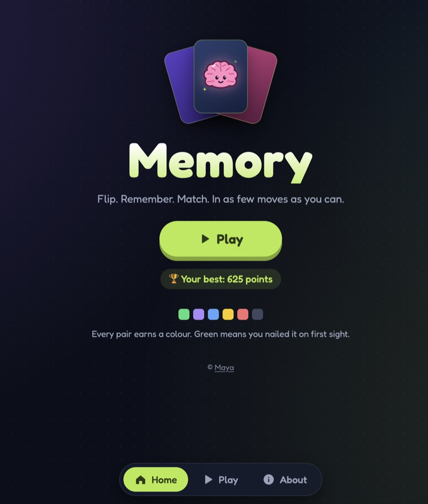
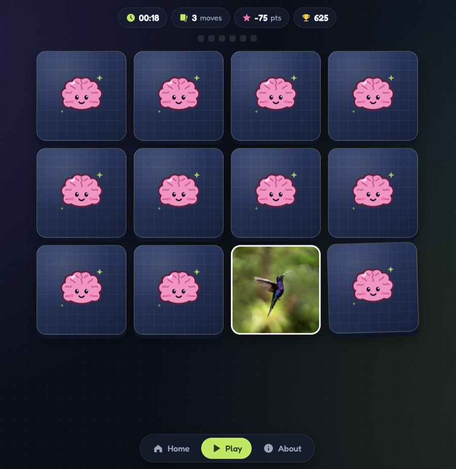
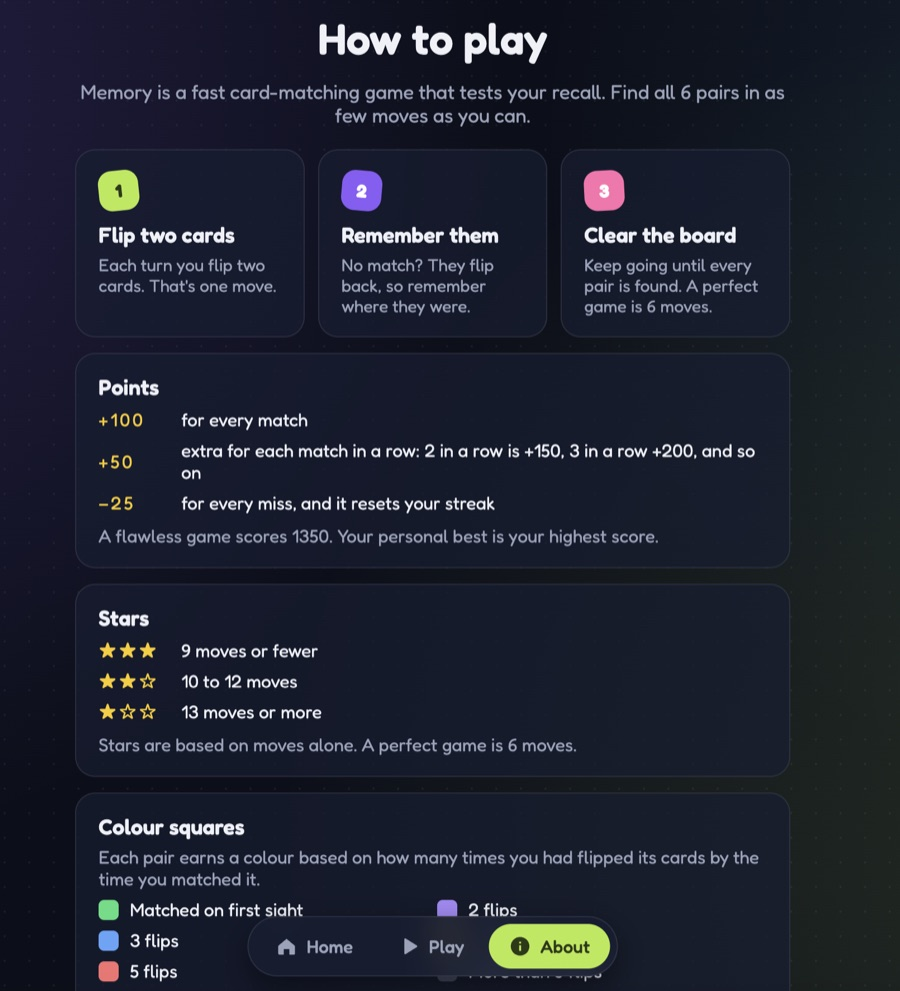

# Memory

A whimsical card-matching game. Flip two cards, remember where they were, and clear the board in as few moves as you can.

<!-- **[▶ Play it live](https://your-app-name.herokuapp.com)** -->

| Home | Game | About |
|:---:|:---:|:---:|
|  |  |  |

## How it plays

- **6 pairs, no move limit.** Keep going until every pair is found.
- **Memory, not luck.** Exploring new cards is free. Only slips, misses you could have avoided, cost points.
- **Streaks pay.** +100 per match, +50 more for each match in a row, −25 per slip.
- **Stars, colours and a personal best** to chase, plus results you can share.
- **No data collected.** Scores stay in your browser, and the font is self-hosted.

## Tech stack

- **Backend:** Python, Flask, served by Gunicorn on Heroku
- **Frontend:** vanilla JavaScript, HTML (Jinja templates) and CSS, with no frameworks
- **Storage:** browser `localStorage` and `sessionStorage` only, with no database
- **Assets:** self-hosted Fredoka font, hand-drawn SVG icons, images auto-optimized with macOS `sips` in a git pre-commit hook

<details>
<summary><strong>Run it locally</strong></summary>

```bash
python3 -m venv .venv
source .venv/bin/activate
pip install -r requirements.txt
git config core.hooksPath .githooks
python app.py
```

Then open http://127.0.0.1:5000

</details>

## License

**Creative Commons Attribution-NonCommercial 4.0 International (CC BY-NC 4.0)**\
This means:
- **You can remix, adapt, and build upon this game**
- **Non-commercial use only**
- **Credit required** (please attribute to the creator)\
More info: [creativecommons.org/licenses/by-nc/4.0](https://creativecommons.org/licenses/by-nc/4.0/)

Made by [Maya](https://maya.mcpherson.io/). The Fredoka font is licensed separately under the [SIL Open Font License](static/fonts/OFL.txt).
